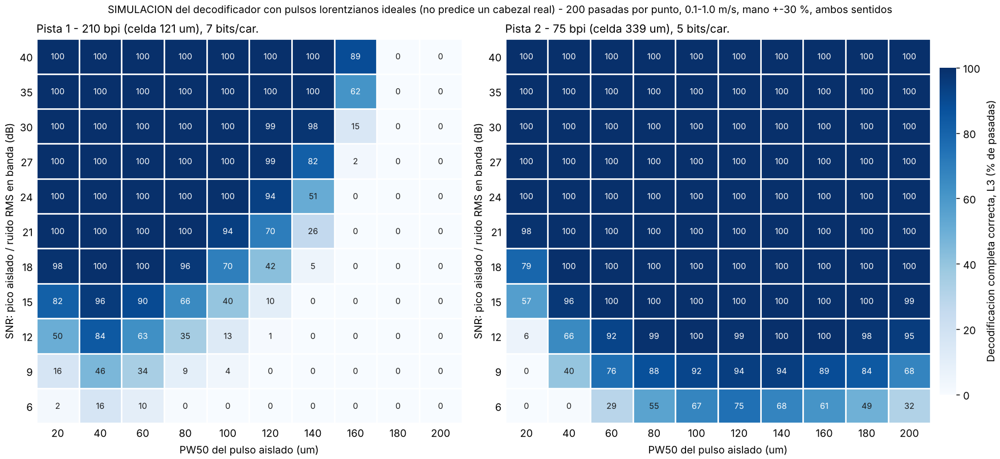

# Exito de decodificacion (L3) frente a SNR y PW50 - simulacion

**Esto es una simulacion del decodificador sobre pulsos idealizados (lorentzianos, ruido blanco gaussiano, sin saltos de amplitud, sin diafonia entre pistas, sin azimut); NO es una prediccion del comportamiento de un cabezal real.** Sirve para saber que PW50 y que SNR necesita el decodificador, no si un cabezal dado los alcanza.

- Decodificador: modulo C del firmware (`fw/common/f2f_decode.c`), configuracion por defecto, 220 puntos x 200 pasadas = 44000 pasadas (269 s).
- Cada pasada: velocidad media log-uniforme 0.1-1.0 m/s, variacion de mano +-30 %, sentido aleatorio, 250 kS/s, AFE 16 Hz - 40 kHz, ADC de 12 bits.
- **SNR** = pico de un pulso AISLADO a la velocidad media / ruido RMS en toda la banda del AFE (dB). No descuenta la perdida de amplitud por interferencia entre pulsos (eso es el eje PW50).
- **PW50** = anchura a media altura del pulso aislado, en um sobre la tarjeta.
- L3 = cadena identica a la esperada, con paridad y LRC correctos.
- Con 200 pasadas por punto, 200/200 equivale a un intervalo de Wilson al 95 % de [98, 100] %; las diferencias de pocos puntos entre celdas vecinas no son significativas.

## Lectura (dentro de los limites de la simulacion)

- El limite por PW50 lo marca la relacion PW50 / celda: el exito cae cuando PW50 se acerca a la celda (los pulsos de '1', separados media celda, se cancelan entre si) y ningun SNR lo arregla por encima de ~1.3 celdas. La pista 1 (celda 121 um) es por tanto la exigente; en la pista 2 toda la rejilla queda por debajo de 0.6 celdas.
- La columna de PW50 = 20 um necesita MAS SNR que las de 40-60 um: los pulsos estrechos a velocidad alta quedan recortados por el paso bajo de 40 kHz y por el muestreo, y el suavizado del decodificador recupera menos ruido.
- El SNR necesario depende de la velocidad (el decodificador promedia mas muestras por pulso en las pasadas lentas); la tabla mezcla 0.1-1.0 m/s.

## Pista 1 (210 bpi) - celda 121 um, media celda 60 um

Porcentaje de pasadas con L3:

| SNR (dB) \ PW50 (um) | 20 | 40 | 60 | 80 | 100 | 120 | 140 | 160 | 180 | 200 |
|---|---|---|---|---|---|---|---|---|---|---|
| 40 | 100 | 100 | 100 | 100 | 100 | 100 | 100 | 89 | 0 | 0 |
| 35 | 100 | 100 | 100 | 100 | 100 | 100 | 100 | 62 | 0 | 0 |
| 30 | 100 | 100 | 100 | 100 | 100 | 99 | 98 | 15 | 0 | 0 |
| 27 | 100 | 100 | 100 | 100 | 100 | 99 | 82 | 2 | 0 | 0 |
| 24 | 100 | 100 | 100 | 100 | 100 | 94 | 51 | 0 | 0 | 0 |
| 21 | 100 | 100 | 100 | 100 | 94 | 70 | 26 | 0 | 0 | 0 |
| 18 | 98 | 100 | 100 | 96 | 70 | 42 | 5 | 0 | 0 | 0 |
| 15 | 82 | 96 | 90 | 66 | 40 | 10 | 0 | 0 | 0 | 0 |
| 12 | 50 | 84 | 63 | 35 | 13 | 1 | 0 | 0 | 0 | 0 |
| 9 | 16 | 46 | 34 | 9 | 4 | 0 | 0 | 0 | 0 | 0 |
| 6 | 2 | 16 | 10 | 0 | 0 | 0 | 0 | 0 | 0 | 0 |

SNR minima de la rejilla a partir de la cual el exito se mantiene por encima del nivel indicado ("-" = no se alcanza ni a 40 dB):

| PW50 (um) | PW50 / celda | SNR min. para >= 95 % | SNR min. para >= 50 % |
|---|---|---|---|
| 20 | 0.17 | 18 | 12 |
| 40 | 0.33 | 15 | 12 |
| 60 | 0.50 | 18 | 12 |
| 80 | 0.66 | 18 | 15 |
| 100 | 0.83 | 24 | 18 |
| 120 | 0.99 | 27 | 21 |
| 140 | 1.16 | 30 | 24 |
| 160 | 1.32 | - | 35 |
| 180 | 1.49 | - | - |
| 200 | 1.65 | - | - |

## Pista 2 (75 bpi) - celda 339 um, media celda 169 um

Porcentaje de pasadas con L3:

| SNR (dB) \ PW50 (um) | 20 | 40 | 60 | 80 | 100 | 120 | 140 | 160 | 180 | 200 |
|---|---|---|---|---|---|---|---|---|---|---|
| 40 | 100 | 100 | 100 | 100 | 100 | 100 | 100 | 100 | 100 | 100 |
| 35 | 100 | 100 | 100 | 100 | 100 | 100 | 100 | 100 | 100 | 100 |
| 30 | 100 | 100 | 100 | 100 | 100 | 100 | 100 | 100 | 100 | 100 |
| 27 | 100 | 100 | 100 | 100 | 100 | 100 | 100 | 100 | 100 | 100 |
| 24 | 100 | 100 | 100 | 100 | 100 | 100 | 100 | 100 | 100 | 100 |
| 21 | 98 | 100 | 100 | 100 | 100 | 100 | 100 | 100 | 100 | 100 |
| 18 | 79 | 100 | 100 | 100 | 100 | 100 | 100 | 100 | 100 | 100 |
| 15 | 57 | 96 | 100 | 100 | 100 | 100 | 100 | 100 | 100 | 99 |
| 12 | 6 | 66 | 92 | 99 | 100 | 99 | 100 | 100 | 98 | 95 |
| 9 | 0 | 40 | 76 | 88 | 92 | 94 | 94 | 89 | 84 | 68 |
| 6 | 0 | 0 | 29 | 55 | 67 | 75 | 68 | 61 | 49 | 32 |

SNR minima de la rejilla a partir de la cual el exito se mantiene por encima del nivel indicado ("-" = no se alcanza ni a 40 dB):

| PW50 (um) | PW50 / celda | SNR min. para >= 95 % | SNR min. para >= 50 % |
|---|---|---|---|
| 20 | 0.06 | 21 | 15 |
| 40 | 0.12 | 15 | 12 |
| 60 | 0.18 | 15 | 9 |
| 80 | 0.24 | 12 | 6 |
| 100 | 0.30 | 12 | 6 |
| 120 | 0.35 | 12 | 6 |
| 140 | 0.41 | 12 | 6 |
| 160 | 0.47 | 12 | 6 |
| 180 | 0.53 | 12 | 9 |
| 200 | 0.59 | 12 | 9 |
